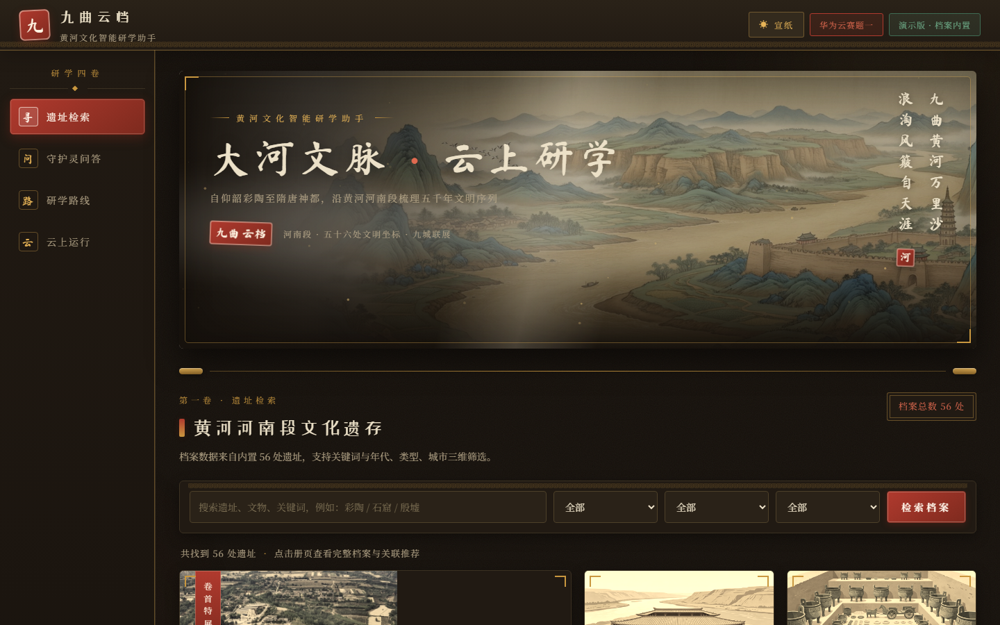
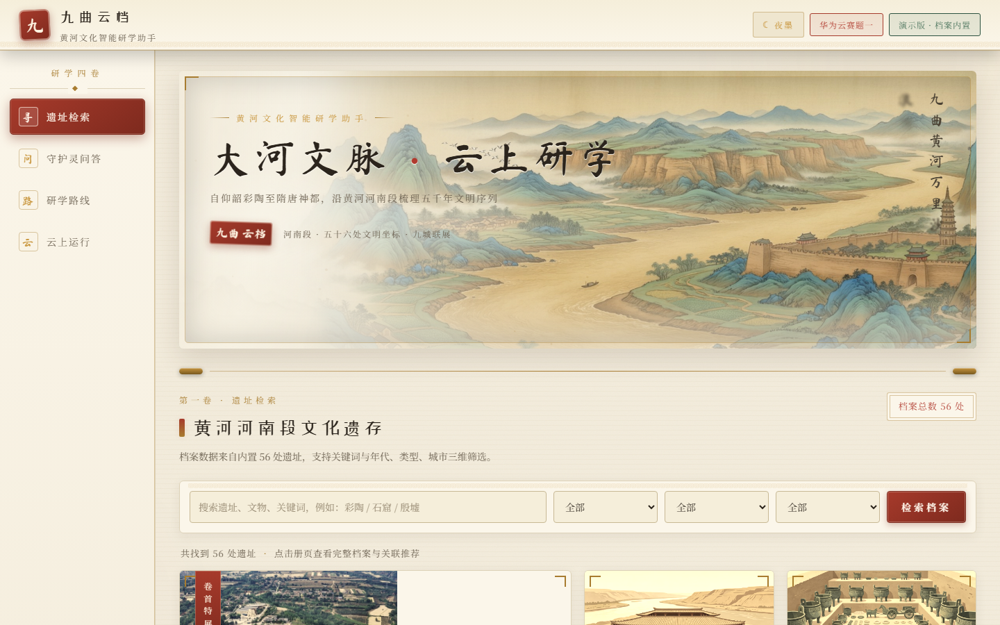
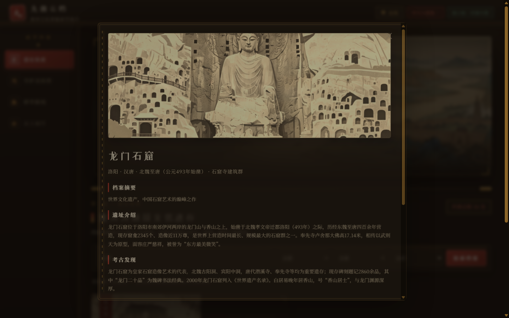
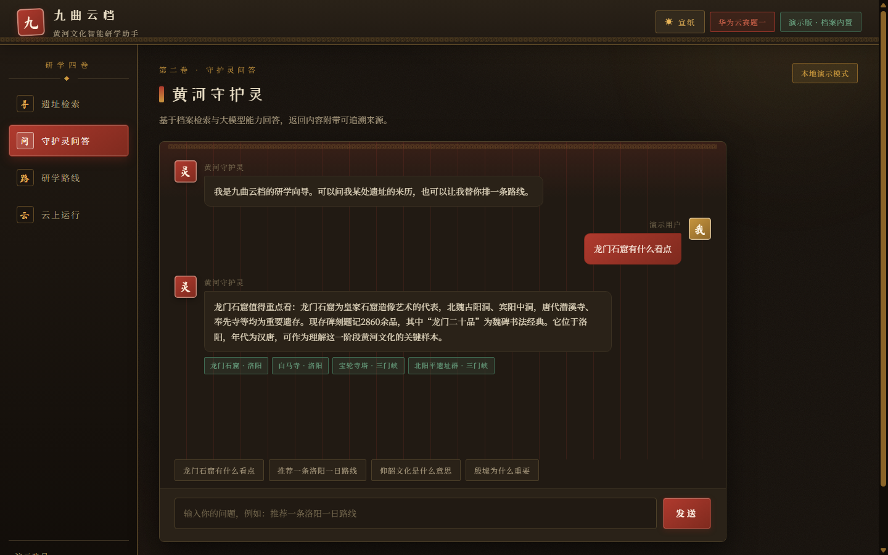
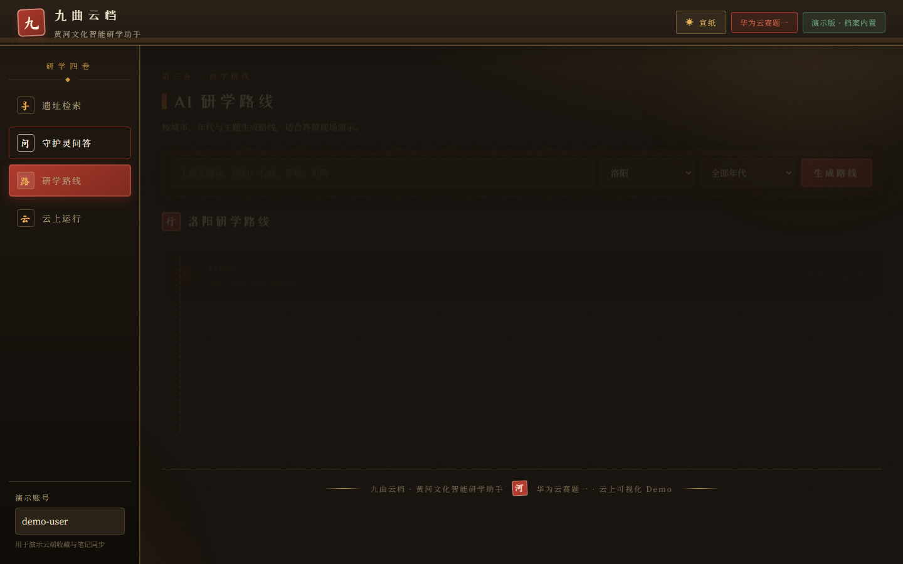
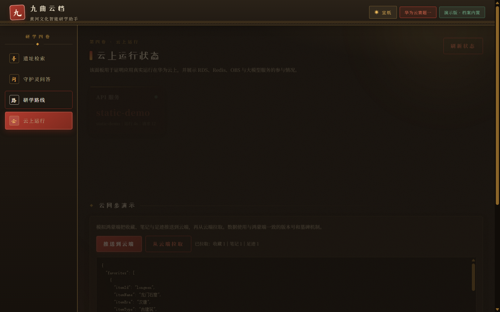
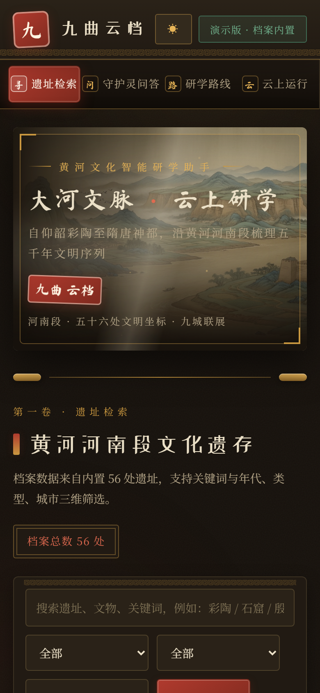
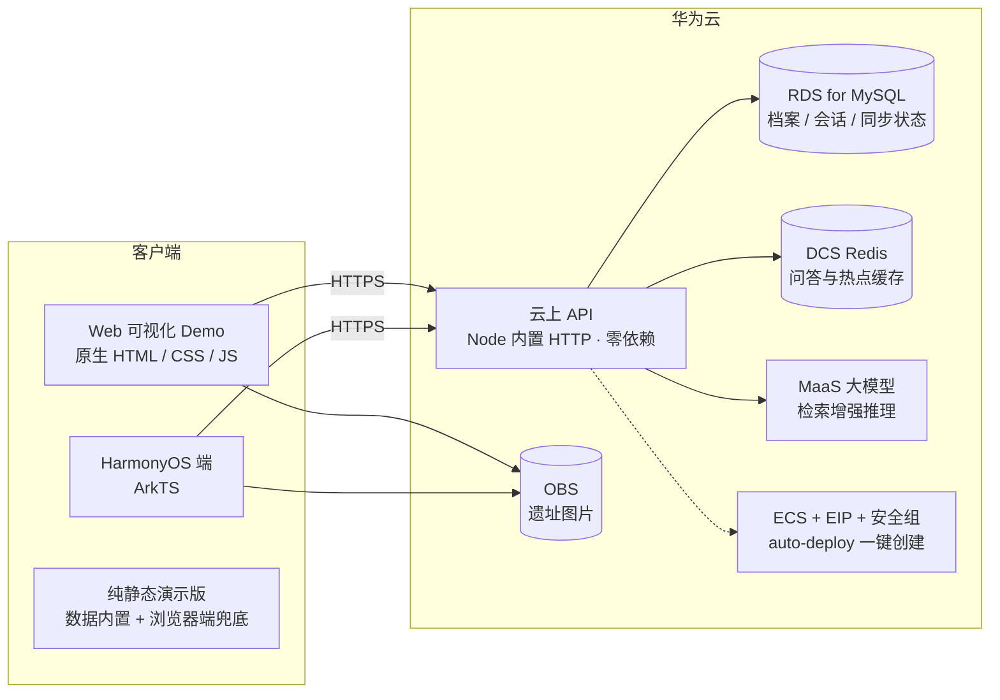

<div align="center">


# 九曲云档 · 黄河文化智能研学助手

**第十一届华为 ICT 大赛中国创新赛 · 赛题一「基于华为云产品打造 AI 创新应用」参赛作品**

把黄河河南段 56 处文化遗存整理成可检索、可问答、可规划路线、可跨设备继续学习的云上研学档案。

[](apps/api/package.json)
[](LICENSE)
[](apps/api/server.js)
[](harmony-app)

[界面预览](#界面预览) · [快速开始](#快速开始) · [技术架构](#技术架构) · [华为云部署](#华为云部署) · [API 一览](#api-一览) · [路线图](#路线图)

</div>

---

## 项目简介

黄河河南段是中华文明的核心腹地，仰韶彩陶、二里头夏都、汉魏洛阳城、龙门石窟等遗存密集分布，但研学资料分散在文保公报、文旅页面与学术文献中：学生查不到可信出处，游客看不懂年代脉络，教师组织一次研学要手工拼凑路线与讲解词，更换设备后学习记录还会中断。

九曲云档用一条云上链路解决这件事：**查得到、问得准、走得顺、换设备接着学**。

- **查得到**：56 处遗址的结构化档案（年代 / 类型 / 城市 / 考古发现 / 代表文物 / 历史事件 / 研学信息），关键词 + 三维筛选检索；
- **问得准**：检索增强问答，回答只依据内置档案并附带可追溯来源，客户端不持有大模型密钥；
- **走得顺**：按城市、年代、类型关联排序生成 2–4 站研学路线，并给出串联理由；
- **接着学**：版本号 + 墓碑机制的云同步，合并多端收藏、笔记与足迹，离线删除不会被旧设备复活。

> **当前状态**：Web 可视化 Demo、云上 API、HarmonyOS 端改造、纯静态演示版均已完成并通过实测；华为云正式部署（RDS / DCS / OBS / MaaS 连通）按 [华为云部署](#华为云部署) 推进中。未配置云资源时自动使用本地数据兜底，功能完整可演示。

## 界面预览

夜墨（漆色展墙）与宣纸（浅色纸本）双主题，首页水墨青绿长卷带入场动效与视差。

| 夜墨 · 首页 | 宣纸 · 首页 |
|---|---|
|  |  |

| 档案详情与关联推荐 | 守护灵问答（附档案来源） |
|---|---|
|  |  |

| 研学路线 | 云上运行状态 | 手机端 |
|---|---|---|
|  |  |  |

## 功能特性

- **遗址检索**：关键词 + 年代 / 类型 / 城市三维筛选，分页浏览，卷首特展卡片；
- **档案详情**：摘要、介绍、考古发现、代表文物、历史事件、研学信息，以及基于年代 / 城市 / 类型权重的关联推荐；
- **守护灵问答**：检索增强 + 来源追溯；未配置大模型时自动切换本地演示模式并明确标注；
- **研学路线**：按城市 / 年代 / 关键词关联排序，输出站点与串联理由；
- **版本化云同步**：`updatedAt / createdAt / viewedAt` 作版本号，`tombstone(kind, id, ts)` 表达删除，多端合并冲突可解；
- **云上运行面板**：API、RDS、Redis、OBS、大模型五项状态与缓存命中统计，一眼看出作品是否真实跑在云上；
- **双主题与动效**：夜墨 / 宣纸一键切换并记忆；长卷入场、印章落款、金粉微粒、鼠标与滚动视差，遵循 `prefers-reduced-motion`；
- **纯静态演示版**：数据内置、浏览器端接口兜底，双击 `index.html` 即可打开，也可整体托管到任意静态空间；
- **HarmonyOS 端**：保留分布式同步特色，云优先加载与问答，密钥全部移至云侧。

## 技术架构

三端一云：Web Demo 与 HarmonyOS 端访问云上零依赖 Node API；API 以检索增强问答组织请求链路，图片走 OBS，档案与会话落 RDS，热点与问答结果走 DCS Redis。



**一次问答的链路**：问题 → 档案检索（RDS / 本地兜底）→ 缓存查询（Redis，命中即返回）→ 受限上下文 + MaaS 推理 → 答案与来源返回 → 问答记录回写 RDS。

**兜底策略**：未配置 `RDS_HOST` 时使用 `rawfile/heritages.json`；未配置 Redis 时使用进程内缓存；未配置 `OBS_IMAGE_BASE_URL` 时走本地 `/images`；未配置大模型时返回本地演示答案并标注模式。任何一环缺失都不阻塞演示。

## 快速开始

环境要求：**Node.js 20+**。API 使用 Node 内置模块，无必选依赖。

### 方式一：本地服务（完整功能）

```bash
cd jiuyu-cloud-mvp
cp .env.example .env        # 不填云资源也能跑，自动本地兜底
node apps/api/server.js
```

浏览器打开 <http://localhost:3000>。

需要真实 RDS / Redis 能力时安装两个可选依赖：

```bash
cd apps/api && npm install && cd ../..
node apps/api/server.js
```

### 方式二：纯静态演示版（双击即开，无需服务）

```bash
node scripts/build-static.mjs
```

产物在 `dist-static/`：56 条档案内置、图片压缩至 ≤960px、问答 / 路线 / 同步在浏览器内兜底完成。
双击 `dist-static/index.html` 即可体验；整个文件夹上传到任意静态托管即得到手机可访问的链接。

> 压图环节使用本机 Chrome / Edge 无头模式；未找到浏览器时自动按原图复制。

### 冒烟测试

```bash
node scripts/smoke-test.js
```

预期 10 项全部 `PASS`（health / meta / heritages / detail / routes / chat / sync / pull / status / web-demo）。

## API 一览

| 方法 | 路径 | 说明 |
|---|---|---|
| GET | `/api/health` | 健康检查 |
| GET | `/api/meta` | 筛选项 facet、档案总数、数据模式 |
| GET | `/api/heritages` | 检索：`keyword / era / type / city / page / pageSize` |
| GET | `/api/heritages/:id` | 档案详情 + 关联推荐 |
| GET | `/api/routes` | 研学路线：`city / era / keyword / limit` |
| POST | `/api/chat` | 守护灵问答：`question / history / userId`，返回 `answer / sources / mode` |
| GET / POST | `/api/sync` | 云同步拉取 / 推送：`userId`，版本号 + 墓碑合并 |
| GET | `/api/status` | 云上运行状态：RDS / Redis / OBS / MaaS 连通与缓存统计 |

## 华为云部署

推荐链路：官方 **auto-deploy Skill** 以自然语言一键创建 ECS / EIP / 安全组并发布应用。完整步骤见 [docs/AUTO_DEPLOY_GUIDE.md](docs/AUTO_DEPLOY_GUIDE.md)。

**需提前开通并写入 `.env` 的资源**（auto-deploy 不会创建这些）：

| 资源 | 环境变量 | 用途 |
|---|---|---|
| RDS for MySQL | `RDS_HOST / RDS_PORT / RDS_USER / RDS_PASSWORD / RDS_DATABASE` | 档案、会话、同步状态 |
| DCS Redis | `REDIS_HOST / REDIS_PORT / REDIS_PASSWORD` | 问答与热点缓存 |
| OBS | `OBS_IMAGE_BASE_URL` | 遗址图片公共读前缀 |
| MaaS | `LLM_BASE_URL / LLM_MODEL / LLM_API_KEY` | 大模型推理 |
| 同步签名 | `SYNC_SECRET` | 云同步签名 |

RDS 初始化：`scripts/schema.sql` + `scripts/seed.sql`（56 条档案）。

**部署步骤**：

1. 在 CodeArts 智能体中安装 auto-deploy Skill；
2. 配置华为云 AK/SK 为环境变量（**不要写进提示词或仓库**）；
3. 填写 `.env`，通过 `--env-file .env` 安全注入；
4. 粘贴部署提示词（见 `docs/AUTO_DEPLOY_GUIDE.md`），Skill 自动分析项目、规划资源、创建 ECS/EIP/安全组、上传代码并健康检查；
5. 保留 `.auto-deploy/` 下的 `analysis.json`、`resource-spec.json`、`deployment-plan.md`、`deployment-test-report.md` 作为过程证据。

**验收**：访问 `http://<公网IP>:3000/api/status`，应满足

```text
data.mode = huaweicloud-rds
services.rds.stats.connected = true
services.redis.ready = true
services.obs.configured = true
services.llm.configured = true
```

备用方案：`scripts/deploy-huaweicloud.sh`（传统部署，仅在无法安装 Skill 时使用）。

## HarmonyOS 端

用 DevEco Studio 打开 `harmony-app/`，修改 `entry/src/main/ets/common/GuardianConfig.ets`：

```ts
static readonly CLOUD_ENDPOINT: string = 'http://<云上API地址>:3000/api';
```

端侧不持有大模型密钥；问答与档案加载云优先，收藏 / 笔记 / 足迹通过 `/api/sync` 与 Web 端合并。改动说明见 [docs/HARMONY_PATCH_NOTES.md](docs/HARMONY_PATCH_NOTES.md)。

## 目录结构

```text
jiuyu-cloud-mvp/
├── apps/api/
│   ├── server.js              # HTTP 路由 + 静态站点（Node 内置模块）
│   ├── static-api.js          # 静态版浏览器端接口兜底层
│   └── lib/                   # rds / redis / obs / llm / sync / store / env
├── web/                       # Web 可视化 Demo（双主题 + 长卷动效）
│   ├── index.html / styles.css / app.js / hero.js
│   └── assets/                # 本地字体、主视觉长卷
├── harmony-app/               # HarmonyOS 端源码（云优先 + 分布式同步）
│   └── entry/src/main/resources/rawfile/   # 56 条档案与遗址图片
├── scripts/
│   ├── build-static.mjs       # 一键打包纯静态演示版
│   ├── schema.sql / seed.sql  # RDS 建表与初始化
│   ├── smoke-test.js          # 10 项接口冒烟测试
│   └── deploy-huaweicloud.sh  # 备用传统部署
├── codearts-skills/           # 5 个可复用 Skills / 模板
├── docs/                      # 架构、部署、开源、数据来源、CodeArts 证据
│   └── screenshots/           # README 界面截图
├── Dockerfile / docker-compose.yml
└── .env.example               # 环境变量样例（不含真实密钥）
```

## 路线图

- [x] 云上 API：检索 / 详情 / 问答 / 路线 / 云同步 / 状态
- [x] 华为云适配层与本地兜底
- [x] Web Demo 双主题视觉精修与长卷动效
- [x] 纯静态演示版（双击即开 / 任意静态托管）
- [x] HarmonyOS 端云优先改造与密钥整改
- [ ] 华为云正式部署与 `/api/status` 证据
- [ ] 收藏 / 笔记 / 足迹真实界面（接现有 `/api/sync`）
- [ ] 调用链路时序可视化（检索 → 缓存 → 推理 → 落库耗时）
- [ ] 九城地图视图与年代时间长卷
- [ ] 流式回答 + 引用角标、研学任务智能体
- [ ] 首屏字体子集化瘦身

## 安全与密钥

- 客户端不持有任何大模型密钥，问答统一经云上 API 代理；
- 真实密钥只存在于运行环境的 `.env`，已加入 `.gitignore`，仓库只提交 `.env.example`；
- auto-deploy 通过 `--env-file` 注入配置，密钥不出现在提示词、报告与仓库中；
- `.auto-deploy/` 含部署过程产物与 SSH keypair，**不要提交到公开仓库**；
- 原始源码中曾硬编码一枚第三方大模型 API Key，本版本已删除；**请在原平台吊销该 Key 并检查历史提交**。

## 数据与素材来源

- 档案数据：`harmony-app/entry/src/main/resources/rawfile/heritages.json`（56 处遗址，9 城、6 个年代段、4 类遗存，含 95 条代表文物与 98 条历史事件），并同步为 `scripts/seed.sql`；
- 遗址图片：同目录 `rawfile/images/`；首页长卷为 AI 生成的水墨青绿风格插画；
- 字体：Ma Shan Zheng、ZCOOL XiaoWei、Noto Serif SC（SIL Open Font License），本地内置以支持离线演示。

> **开源前请确认**：新增代码以 MIT 许可发布；原始档案数据与遗址图片的公开授权需由团队向来源方确认，详见 [docs/DATA_SOURCES.md](docs/DATA_SOURCES.md)。

## 赛题要求映射

| 赛题要求 | 本仓库对应内容 |
|---|---|
| 使用华为云码道 CodeArts 代码智能体 | `codearts-skills/`、[docs/CODEARTS_EVIDENCE.md](docs/CODEARTS_EVIDENCE.md) |
| 智能体 + Skills 关联 RDS / Redis 快速开通创建 | `apps/api/lib/rds.js`、`redis.js` 与云资源规划 / 数据导入 Skills |
| 智能体 + Skills 实现华为云快速部署 | auto-deploy Skill 一键部署，[docs/AUTO_DEPLOY_GUIDE.md](docs/AUTO_DEPLOY_GUIDE.md) |
| 云上可视化 Demo | `web/` 与 `/api/status` 状态面板 |
| 开源材料 | [LICENSE](LICENSE)、[docs/OPEN_SOURCE_CHECKLIST.md](docs/OPEN_SOURCE_CHECKLIST.md)、[docs/DATA_SOURCES.md](docs/DATA_SOURCES.md) |

## 许可证

[MIT](LICENSE) © 2026 九曲云档参赛团队
