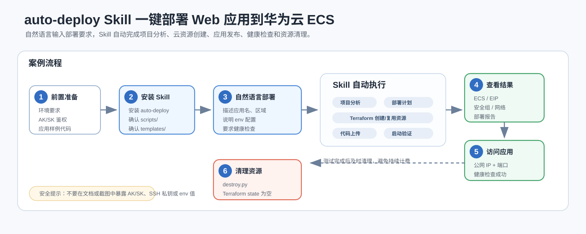

# 使用 auto-deploy Skill 一键部署 Web 应用到华为云 ECS

## 一、概述

### 1.1 案例介绍

本案例将引导开发者使用 `auto-deploy` Skill，通过自然语言将一个 Web 应用部署到华为云 ECS。用户无需手工编写 Terraform 配置、SSH 上传脚本或 systemd 服务文件，只需要描述部署目标，智能体即可自动完成项目分析、云资源创建、应用发布、健康检查和结果报告。

`auto-deploy` Skill 的定位是：**面向单台 ECS 的 Web 应用快速部署**。它适合演示环境、测试环境、验证环境和轻量 Web 应用部署。

**解决的核心问题**：

- 传统方式：手动准备 ECS、EIP、安全组、运行时和部署脚本，步骤多、易出错、复现成本高。
- 智能方式：自然语言描述部署需求，Skill 自动分析项目并完成单台 ECS 部署闭环。

### 1.2 项目亮点

- **自然语言驱动**：用户只需描述应用路径、应用名称、区域和部署目标。
- **自动识别技术栈**：支持 Node.js、Python、Java、Go、Rust、.NET、Dockerfile、Docker Compose 等常见 Web 项目。
- **云资源自动创建**：通过内置 Terraform 模板创建 ECS、EIP、安全组、VPC/子网或复用已有网络。
- **应用自动发布**：通过 SSH 上传代码，安装运行时，构建并启动服务。
- **智能规格适配**：支持通过 `--flavor-tier` 指定 ECS 规格（minimal/small/standard/performance），也可在自然语言中用"最便宜""高性能"等关键词表达规格需求，智能体自动映射到对应实例类型。
- **安全默认值**：SSH 端口默认只允许控制机公网 IP `/32` 访问，环境变量通过安全注入机制传递。
- **可验证、可清理**：部署后自动健康检查，并支持通过 Terraform 状态清理资源。

### 1.3 适用对象

- 企业开发者、测试工程师、解决方案工程师。
- 需要快速验证 Web 应用云上运行效果的开发者。
- 希望用智能体完成 ECS 单机部署流程的用户。

### 1.4 案例流程

本案例总时长预计 **20-30 分钟**，主要流程如下：

1. 准备运行环境、华为云账号和 AK/SK 凭证。
2. 准备一个可部署的 Web 应用项目代码。
3. 在智能体环境中安装 `auto-deploy` Skill。
4. 使用自然语言输入部署要求。
5. 查看自动创建的云资源和部署执行结果。
6. 访问应用公网地址，确认服务运行正常。
7. 清理 Terraform 状态管理的云资源。



---

## 二、前置准备

### 2.1 环境要求

| 依赖           | 版本/要求                                           | 说明                                |
| -------------- | --------------------------------------------------- | ----------------------------------- |
| 智能体运行环境 | 支持 华为云码道、AI shell 或兼容 Skill 机制的agent | 用于安装和调用`auto-deploy` Skill |
| Python         | 3.10+                                               | 执行 Skill 内置 Python 脚本         |
| Bash           | Git Bash / Linux Bash / WSL                         | 执行分析、部署和验证脚本            |
| Terraform      | 1.8.0+                                              | 创建和销毁华为云资源                |
| Git            | 2.0+                                                | 拉取 Skill 仓库和应用样例代码       |
| SSH / SCP      | 系统可用                                            | 上传代码并远程执行部署命令          |
| 华为云账号     | 已实名认证并有资源配额                              | 创建 ECS、EIP、安全组等资源         |

**推荐环境**：

- Windows 环境建议安装 Git Bash，并确保 `bash`、`ssh`、`scp` 可用。
- Terraform 建议使用华为云镜像源或可访问的 provider 下载源。
- 确保当前账号在目标区域有 ECS、EIP、VPC、安全组和 KPS keypair 的创建权限。

### 2.2 凭证准备

本案例使用华为云 AK/SK 进行 Terraform 鉴权。请提前在华为云控制台创建访问密钥。

**获取方式**：

1. 登录 [华为云控制台](https://console.huaweicloud.com/)。
2. 进入“我的凭证”。
3. 进入“访问密钥”。
4. 创建访问密钥并下载保存。


### 2.3 配置 AK/SK 鉴权

`auto-deploy` Skill 会从环境变量读取华为云凭证。任选一种方式配置即可。

**方式一：使用 HW_ACCESS_KEY / HW_SECRET_KEY**

```bash
export HW_ACCESS_KEY="<YOUR_AK>"
export HW_SECRET_KEY="<YOUR_SK>"
```

Windows PowerShell：

```powershell
$env:HW_ACCESS_KEY="<YOUR_AK>"
$env:HW_SECRET_KEY="<YOUR_SK>"
```

**方式二：使用 HUAWEICLOUD_ACCESS_KEY / HUAWEICLOUD_SECRET_KEY**

```bash
export HUAWEICLOUD_ACCESS_KEY="<YOUR_AK>"
export HUAWEICLOUD_SECRET_KEY="<YOUR_SK>"
```

Windows PowerShell：

```powershell
$env:HUAWEICLOUD_ACCESS_KEY="<YOUR_AK>"
$env:HUAWEICLOUD_SECRET_KEY="<YOUR_SK>"
```

**验证凭证是否可用**：

在 Skill 目录中执行：

```bash
python scripts/env_utils.py
```

如果返回结果中 `HW_ACCESS_KEY` 和 `HW_SECRET_KEY` 为 `True`，说明凭证已被当前环境识别。

### 2.4 应用代码准备

请提前准备一个可以启动的 Web 应用样例。也可以使用本案例提供的 [样例应用代码](https://gitcode.com/weixin_43883336/OpsBoard_Lite.git)：

### 2.5 准备完成标志

完成前置准备后，请确认：

- 已准备好智能体运行环境。
- 已安装 Python、Bash、Terraform、Git、SSH/SCP。
- 已获取华为云 AK/SK。
- 当前环境变量中已配置华为云鉴权信息。
- 已准备好 Web 应用样例代码。
- 已确认目标区域有创建 ECS、EIP、安全组等资源的配额。

---

## 三、实操步骤

### 3.1 步骤 1：安装 auto-deploy Skill

在码道智能体中输入安装 Skill 的自然语言指令。Skill 地址由读者根据公司 Skill 仓库地址补充：

```text
帮我安装 auto-deploy skill，Skill 地址是：https://gitcode.com/weixin_43883336/auto-deploy
```

如果使用命令行或公司内部 Skill 管理工具，请按照公司 Skill 仓库规范安装到本地 Skill 目录。

安装完成后，确认 Skill 目录中包含以下核心文件：

```text
SKILL.md
scripts/
templates/
README.md
```

**结果**：`auto-deploy` Skill 安装完成，agent可以识别并调用该 Skill。

>在码道安装skill成功，如图所示


---

### 3.2 步骤 2：自然语言输入部署要求

进入应用样例代码目录后，在智能体中输入部署需求。例如：

```text
使用 auto-deploy skill，把当前 Web 应用部署到华为云 ECS。
应用名 auto-deploy-demo，区域 cn-north-4。
如果应用需要环境变量，请使用 --env 或 --env-file 安全注入。
部署完成后执行健康检查，并输出部署报告。
```

如果样例应用需要环境变量，可以在自然语言中明确说明：

```text
使用 auto-deploy skill 部署当前项目到华为云 ECS。
应用名 auto-deploy-demo，区域 cn-north-4。
应用需要 DATABASE_URL=sqlite:///tmp.db 和 PORT=8000。
请通过安全环境变量注入方式传递配置，不要把变量值写入报告。
部署完成后进行健康检查。
```

**指定 ECS 规格**：

部署时可以通过自然语言关键词指定 ECS 规格，智能体会自动映射到 `--flavor-tier` 参数：

| 关键词示例                         | flavor-tier | 实例类型     | 规格       |
| ---------------------------------- | ----------- | ------------ | ---------- |
| "最便宜""最基础""最低配"           | minimal     | s6.micro.1   | 1 vCPU/1GB |
| "小规格""轻量""小型"               | small       | s6.large.2   | 2 vCPU/4GB |
| "标准""默认""普通"                 | standard    | s6.large.2   | 2 vCPU/4GB |
| "高性能""大规格""生产环境"         | performance | s6.xlarge.2  | 4 vCPU/8GB |

示例：

```text
使用 auto-deploy skill 部署当前项目到华为云 ECS。
应用名 demo，区域 cn-north-4，用最便宜的规格。
```

```text
使用 auto-deploy skill 部署当前项目到华为云 ECS。
应用名 demo，区域 cn-north-4，高性能规格，生产环境部署。
```

> 不指定规格时，Skill 根据应用类型自动选择：Java/Spring → performance（4 vCPU/8GB），其他语言 → standard（2 vCPU/4GB）。

Skill 会自动完成以下操作：

1. 分析项目类型、框架、端口、启动命令和健康检查路径。
2. 生成 `analysis.json`。
3. 生成 `resource-spec.json`。
4. 生成 `deployment-plan.md`。
5. 创建或复用 SSH keypair。
6. 通过 Terraform 创建 ECS、EIP、安全组和网络资源。
7. 上传应用代码。
8. 在 ECS 上安装运行时、启动服务。
9. 执行远端服务状态检查、端口检查和 HTTP 健康检查。


**结果**：Skill 开始执行部署流程，并持续输出分析、计划、创建资源、上传代码、启动服务和验证结果。如图所示


---

### 3.3 步骤 3：查看云资源和执行结果，访问应用

部署完成后，Skill 会输出部署摘要。如图所示：


可以在华为云控制台查看自动创建的资源：

- ECS 实例
- 弹性公网 IP
- 安全组
- 安全组规则
- VPC/子网，或复用的已有 VPC/子网
- KPS keypair


如图所示：华为云控制台 ECS 资源


同时，Skill 会在工作目录下生成 `.auto-deploy` 目录，常见输出包括：

| 文件                          | 说明         |
| ----------------------------- | ------------ |
| `analysis.json`             | 项目分析结果 |
| `resource-spec.json`        | 云资源规格   |
| `deployment-plan.md`        | 部署计划     |
| `run-summary.json`          | 执行摘要     |
| `timings.json`              | 各阶段耗时   |
| `deployment-test-report.md` | 部署验证报告 |

访问应用：
示例应用代码访问成功


---

### 3.4 步骤 4：清理资源

为避免云资源持续计费，测试完成后请及时清理资源。建议通过 Skill 提供的 Terraform 状态执行销毁，不要手工删除部分资源后继续复用同一个 Terraform 状态。

在智能体中输入：

```text
使用 auto-deploy skill 清理本次部署创建的华为云资源。
请根据 .auto-deploy 目录中的 Terraform 状态执行销毁，并确认 ECS、EIP、安全组等资源已删除。
```

如果在非交互环境中执行，并已确认要删除这些资源，可以使用：

```bash
python scripts/destroy.py --workdir <APP_REPO_PATH>/.auto-deploy/terraform --auto-approve
```

**确认清理结果**：

- ECS 已删除。
- EIP 已释放。
- 安全组和安全组规则已删除。
- Skill 创建的 KPS keypair 已删除。
- Terraform state 中无剩余资源。


---

## 四、总结

通过本案例，开发者可以使用 `auto-deploy` Skill 将 Web 应用部署到华为云单台 ECS，并完成从需求描述到资源创建、应用启动、健康检查和资源清理的完整闭环。

完整流程可以概括为：

```text
自然语言部署需求 -> 项目分析 -> 部署计划 -> ECS 资源创建 -> 代码上传 -> 应用启动 -> 健康检查 -> 报告输出 -> 资源清理
```

`auto-deploy` Skill 的价值在于把单台 ECS Web 应用部署流程标准化、自动化和可验证化。用户不需要手工编写 Terraform 模板，也不需要手工准备 SSH 上传、systemd 服务和健康检查脚本。

本案例适合用于：

- Web 应用快速上云验证。
- 单机 API 服务演示。
- 企业内部 PoC。
- 开发、测试、培训和教学场景。

需要注意的是，`auto-deploy` Skill 保持了明确边界：它只面向单台 ECS Web 应用快速部署，不创建 RDS、Redis、OBS、MQ、CCE、Kubernetes、ELB 等复杂云资源。如果应用依赖数据库、缓存、对象存储或消息队列，请提前准备这些外部服务，并通过 `--env` 或 `--env-file` 注入连接信息。

实操结束后，请及时清理云资源和临时凭证，避免持续计费和凭证泄露风险。
